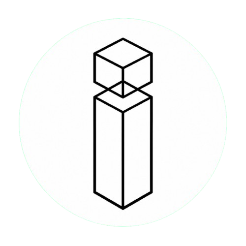

  

  <strong>custom internal application development studio.</strong>

  
  
  
  

***Internal Application*** *is a directory  where early stage founders and entrepreneurs discover SaaS built by our team, with the option to request custom-built internal application tailored to their business.*